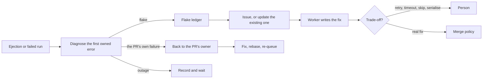

# Loop 3: CI failures → flake fixes → merge

When the merge queue ejects a PR, or the default branch goes red, the supervisor finds out why and fixes the cause. It never reruns CI blindly.

[Back to the graph](graph.md)

## Diagnosis

Diagnosis follows the [review-ci-logs](https://github.com/jonathanong/harness-plugins) skill: find the first error the repository owns, in the failing step, rather than reading whole logs. Each failure is classed as:

| Class | Action |
| --- | --- |
| The PR's own failure | The PR's owner fixes it, then rebases and re-queues |
| Flake | Ledger, issue, fixer in the same tick |
| Infrastructure or outage | When a third-party status page reports an outage at the failure time, record it and skip the fixer |

## Flake ledger

The supervisor keeps a ledger keyed by repository and failure fingerprint: occurrences, the issue, the fix PR and when it merged.

- Before filing, it checks whether the flake is already tracked.
- An issue closes only after a set number of green default-branch and merge-queue runs of that test.
- Reruns that passed count as flake evidence, never as a fix. That way, flakes that never ejected a PR are found too.

## Trade-offs are not fixes

A flake fix that adds a retry, raises a timeout, skips a test or serialises a suite trades coverage for green. A diff check flags these changes. A flagged fix does not merge on its own: it goes to a person, with the flag as the reason.

## Cancelling runs

Superseded runs on PR branches may be cancelled without asking. Runs on the default branch are never cancelled.

## Merging

The supervisor merges only once the repository's required checks pass, through [pr-shepherd](https://github.com/jonathanong/pr-shepherd), and only what the [merge policy](merge-policy.md) allows on the current head. A re-queue of the same head after an ejection is covered by the approval that head already has. A new head needs a fresh final review.

## When the default branch breaks anyway

With a merge queue this should not happen. When it does, the cause is usually a skipped queue, a flaky check, or two changes that pass apart and fail together. The supervisor dispatches a forward fix first. It reverts only a merge it made itself, and only when no forward fix is ready within the time two CI runs take. A revert reopens the work as an issue, with the failing run linked.
