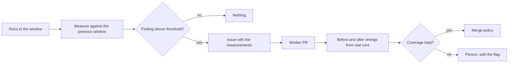

# Loop 9: CI performance → faster, cheaper CI

[Loop 3](ci-and-merging.md) reacts to failures. This loop works on CI that passes but is slow, queued or wasteful. Each sweep measures CI against the previous window and proposes changes backed by numbers.

[Back to the graph](graph.md)

## Signals

| Signal                                        | Points at                                                         |
| --------------------------------------------- | ----------------------------------------------------------------- |
| Queue time per runner label                   | Too few runners of one kind, or jobs that could use another label |
| Slowest jobs and steps, and the critical path | Where time goes; what to split, cache or parallelise              |
| Cache hit rate                                | Cache keys that miss, or caches that are never restored           |
| Minutes per workflow                          | Cost, and workflows that grew                                     |
| Merge-queue wait                              | Checks that hold the queue                                        |
| Runs cancelled by a newer run                 | Time wasted by concurrency groups                                 |
| Unbalanced test shards                        | Shards to rebalance                                               |
| Jobs that run on unrelated paths              | Missing path filters                                              |
| Required checks that never report             | PRs stuck waiting on a check no workflow produces                 |

Every finding names the repository, the workflow and the job, with links to the runs it was measured from.

## The gate

- **Measured, not predicted.** The PR description shows before and after timings from real runs of the changed workflow, over enough runs to be clear of noise.
- **Coverage kept.** The same tests run, and no required check is dropped. The [trade-off detector](ci-and-merging.md#trade-offs-are-not-fixes) flags a change that runs fewer tests, shrinks a matrix, skips a step, or moves to paid larger runners. A flagged change goes to a person, with the flag as the reason.
- **Workflows are always a person's call.** A change under `.github/workflows` is on the always-human list in the [merge policy](merge-policy.md), so it never merges on its own. A change to test configuration or caching elsewhere follows the policy as usual.
- **Default-branch runs are never cancelled** to save time. Superseded runs on PR branches may be.

## Follow-through

After a change merges, the next windows confirm the gain held. A gain that faded reopens the issue. Like [loop 2](skill-feedback.md), a fix that works becomes a principle: it goes in the shared GitHub Actions guidance, so new workflows start fast.
