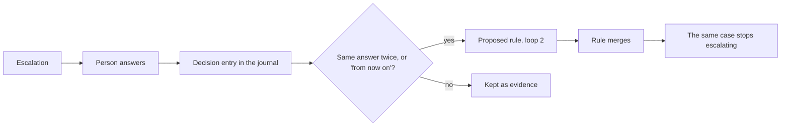

# Loop 5: escalations → rules

Every question the supervisor brings a person is a sign that a rule is missing. Without this loop, the answer is used once and lost.

[Back to the graph](graph.md)

1. **Record each answer.** The supervisor writes each escalation and its answer to the journal as a decision entry. It records the question, the answer, the repository, the PR or issue, and whether the person said it applies from now on.
2. **A repeat means a rule.** Distill matches decisions. The same answer twice, or once with "from now on", becomes a proposed change. It can be a merge-policy rule, a config value, an `AGENTS.md` line, or a principle in a shared skill. It takes [loop 2](skill-feedback.md)'s path, including the [privacy](privacy.md) rules: the decision stays private, and only the general rule reaches a public repository.
3. **Some rules expire.** Instructions such as "no usage floor until the reset" are tied to a time or a state. They are recorded with an expiry rather than as permanent rules.
4. **One batch.** Proposals arrive together in one digest, each with the decisions behind it and a recommended answer. Non-urgent escalations are batched the same way. The age of each open escalation is tracked: an old one means the system is waiting on a person.

## The measure

Two numbers, both of which should fall:

- escalations per week
- the share of escalations that repeat an earlier answer

Routine steps an agent asks permission for (rebase, close a finished issue, cancel a superseded run) are the first to go. When a category of question gets the same obvious "yes" twice, the supervisor proposes a rule and stops asking.
