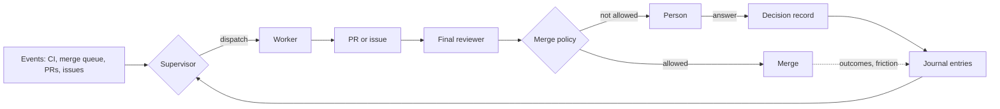

# The graph

supervisor is an autonomous, self-improving graph of coding agents. Its goals are:

1. **Autonomous.** Work goes from an event to a merged PR with no prompt to a person, wherever the merge policy allows it.
2. **Self-improving.** Friction an agent records becomes a rule, a skill change or an issue, so the same mistake costs less next time.

This page is the overview. Each part of the graph has its own page, linked below.

## Who does what

The supervisor watches, routes, restarts and decides. It does none of the work itself, in the Erlang sense of a supervisor.

| Tier | Who | Does | Merges |
| --- | --- | --- | --- |
| Supervisor | One long-running agent session | Waits on events, runs sweeps, routes work, reviews outcomes, escalates | Only what the [merge policy](merge-policy.md) allows, and only PRs no other live agent owns |
| Repo orchestrators | One session per repository or lane, any harness | Own their repository's work and PRs | Their own repository, under the same policy |
| Workers | Subagents in isolated worktrees | Open every PR: fixes, flake fixes, skill changes | Never |
| Final reviewer | A separate review agent | Reviews the current head of a PR before merge | Never |

One supervisor covers many scopes: GitHub organizations and user accounts, each with its own list of repositories and its own mode. A scope in `report` mode is triaged and reported on, with no worker PRs and no merges.

## The spine

Every loop shares one path: an event or a journal entry arrives, the supervisor classifies it, a worker produces a PR or an issue, the final reviewer approves the head, and the merge policy decides whether the PR merges or goes to a person.

The dotted edge and the decision record are what make it self-improving. Merges, failures and answers flow back into the journal, and the journal is distilled into rules.

## The loops

| Loop | From | To | Page |
| --- | --- | --- | --- |
| 1. Journal | Friction agents record in sessions | Issues and rule change requests | [journal.md](journal.md) |
| 2. Skill feedback | Change requests from loops 1 and 5, and review findings | Skill and rule changes merged on an eval delta | [skill-feedback.md](skill-feedback.md) |
| 3. CI and merging | Merge-queue ejections and CI failures | Flake fixes, then merges | [ci-and-merging.md](ci-and-merging.md) |
| 4. Claims and taxonomy | Agents picking up work | Ownership, milestones and labels on GitHub | [claims-and-taxonomy.md](claims-and-taxonomy.md) |
| 5. Escalations | Questions the supervisor brings a person | Rules, so the question is not asked again | [escalations.md](escalations.md) |
| 6. Backlog | Ready issues in open milestones | Dispatched work | [backlog.md](backlog.md) |

Loop 1 feeds loop 2: a distilled theme whose fix is a rule becomes a skill change request. Loop 5 feeds loop 2 the same way. Loops 2, 3 and 6 produce PRs, and all of them pass the same merge gate.

## Cross-cutting parts

- [merge-policy.md](merge-policy.md): what may merge without a person, written in the Claude Approvals `approvals.yml` format.
- [dispatch.md](dispatch.md): where work runs, and how usage limits across several accounts and harnesses shape it.
- [privacy.md](privacy.md): what may leave a private repository, and how that is enforced before a push.
- [guardrails.md](guardrails.md): shadow mode, merge records, the stop switch, and what the supervisor may never change about itself.
- [use-cases.md](use-cases.md): the real incidents this design answers.

## State and wake-ups

- **Events wake the supervisor.** It waits on GitHub events (ejections, failed default-branch runs, PR closes, Dependabot PRs, commands in comments) through [hook-harness](https://github.com/jonathanong/hook-harness), with one wait and one cursor per owner.
- **A fallback sweep** runs on a timer, every few hours, in case an event was missed. Nothing polls while the event wait is healthy.
- **The journal lives in [agent-blackboard](https://github.com/jonathanong/agent-blackboard).** Agents write entries with its own tools, against JSON Schemas registered on the server. Retrospectives are entries under a retrospective schema.
- **Local state** (cursors, the flake ledger, merge records) is one file the supervisor owns. It is private and never committed to a public repository.

## Surfaces

| Surface | Holds |
| --- | --- |
| `supervisor` CLI | The supervisor's own steps: `policy check` and `policy explain`, distill classify and route, claim reconciliation, `prepush` |
| MCP server | Tools for agents: `pr_create`, `pr_update`, `pr_validate`, `session_facts`, `policy_check` |
| Skills | Procedures that are not code: the supervisor loop, the skill-feedback procedure, claims |
| JSON Schemas | Journal entry shapes, registered in agent-blackboard |
| Config | One JSON file per installation, kept private. Scopes, provenance fields, who may merge, how to request the final review |

## Harness agnostic

Skills name capabilities, not tools: a recurring job, a self-paced wake-up, a background command, an isolated worker, a message to another session, an escalation to a person. An adapter per harness maps each capability to that harness's tool. A harness with no recurring-job tool can still run single sweeps on request.

Any harness can run workers and sweeps. Merging stays with an attended Claude session, as the merge policy's host and model settings require.
