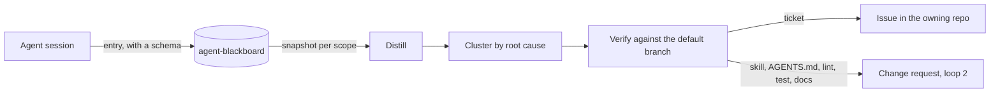

# Loop 1: journal → action items

Agents record friction as they work: a check that failed and then recovered, a sandbox denial, a missing tool, a scope change, the same fix applied twice. The supervisor distills those entries into action items, each routed to where its fix belongs.

[Back to the graph](graph.md)

## Writing entries

- Agents write to [agent-blackboard](https://github.com/jonathanong/agent-blackboard) with its own MCP tools. There is no wrapper.
- Every entry names a JSON Schema registered on the server, and the server validates the entry against it. A new schema can run in shadow mode first, so it can be tested without rejecting other agents' writes.
- A retrospective is an entry under a retrospective schema, written from verified facts about the session: commits, PRs, checks and issues closed. The MCP tool `session_facts` supplies those facts.

## Distilling

1. **Per scope.** Distill runs once per scope, over the sessions whose entries name that scope's repositories.
2. **Cluster.** Entries are grouped by root cause across sessions and repositories, not by wording.
3. **Verify.** Each cluster is checked against the current default branch. A problem already fixed is dropped.
4. **Promote.** A theme becomes an action item when it recurs in two or more sessions, or once when its severity is high.
5. **Route by destination.** Each action item carries a destination:

| Destination                                  | Goes to                                                                                    |
| -------------------------------------------- | ------------------------------------------------------------------------------------------ |
| `ticket`                                     | An issue in the repository it concerns                                                     |
| `skill`, `AGENTS.md`, `lint`, `test`, `docs` | A change request in [loop 2](skill-feedback.md), against the repository that owns the rule |

A finding about a private repository stays in that repository. See [privacy.md](privacy.md).

## Coverage

A session that hit friction and wrote nothing looks the same as a clean one. So for each merged PR an agent wrote, the supervisor checks that its session left at least one entry, or an explicit "nothing observed" record. The sweep summary reports that ratio per repository.

"MCP unavailable" is a signal of its own. When an agent could not reach the journal, that gets recorded and counted rather than lost.
