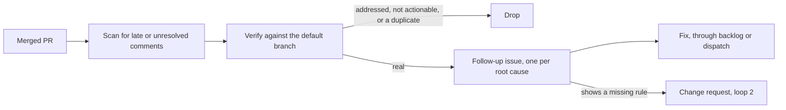

# Loop 7: late reviews → follow-up issues

A review comment can arrive after its PR merged, or a PR can merge with a review thread still open. Either way the comment would be lost. This loop finds those comments and turns the real ones into follow-up issues.

[Back to the graph](graph.md)

## Finding them

A comment is harvested when it was created after the PR merged, or was still unresolved when it merged. Review comments, review threads and review bodies all count.

- **On merge:** as soon as the supervisor sees a PR merge, it checks that one PR.
- **Each sweep, incrementally:**
  - every PR merged since the last scan, within a window (default 14 days)
  - older merges in the window that have new review activity
- **A weekly backstop** rescans every PR in the window. A review with only a body appears in neither comment list, so this catches it.

Cursors advance only after a scan succeeds, so a failed or skipped scan never hides a comment. A list of handled comment ids prevents duplicate issues between the on-merge check and the sweep.

## Filing

- Each comment is checked against the current default branch. Anything already addressed, not actionable, or a duplicate of an open issue is dropped.
- What remains is filed as one issue per root cause, with a `follow-up` label and a non-closing link to the PR and comment.
- A comment counts as handled only once its issue's label and link are verified. If labelling or linking is blocked, the comment stays unhandled and a later sweep retries it.

When a late comment shows that a skill or rule is missing, for example the same review finding on several PRs, it also becomes a change request in [loop 2](skill-feedback.md).
