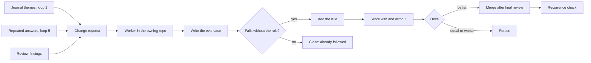

# Loop 2: feedback → skill and rule changes

This is the self-improving loop. A mistake an agent made becomes a rule, and the rule merges only when an eval shows it helps.

[Back to the graph](graph.md)

## One change-request shape

Every source files the same kind of issue in the repository that owns the rule:

- the mistake observed
- links to the evidence: PR, review comment, session
- the skill or rule file that owns it
- the proposed rule, in one sentence
- a sketch of the eval case

**Routing:**
- general principles go to the shared skills repository, [harness-plugins](https://github.com/jonathanong/harness-plugins)
- hard "must not" rules go to a static checker such as [no-mistakes](https://github.com/jonathanong/no-mistakes)
- an organization's or repository's own policy goes to that repository's `AGENTS.md`

## Case first, then rule

A worker in the owning repository:

1. writes the eval case
2. confirms the model fails it without the rule
3. adds the rule
4. runs both arms, with and without the rule
5. puts both scores in the PR description

Rules a model already follows unaided are not added. Later, rules a newer model follows unaided are candidates for removal.

## The merge gate

| Result | Outcome |
| --- | --- |
| Better with the rule | May merge once the final reviewer approves the head |
| Equal | Goes to a person |
| Worse | Goes to a person |
| Changes the eval runner or its scripts | Always goes to a person |

Shared skills reach every session as soon as they merge, so the eval delta is the only thing between a bad rule and every agent. That is why changes to the eval runner are never merged autonomously.

## Recurrence check

A change request stays open until a later distill window shows no new instance of the mistake. A rule that merged and did not help is evidence for its next revision.

## Paid eval runs

A large or paid eval run is a budget decision. The supervisor queues it for after the next usage reset rather than spending a scarce account on it. See [dispatch.md](dispatch.md).
