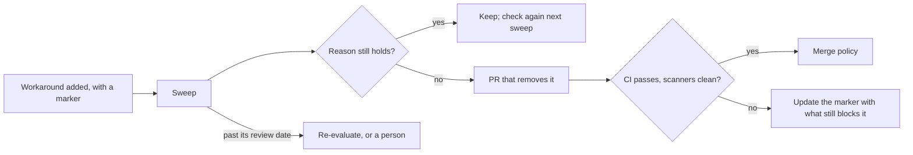

# Loop 10: temporary workarounds → removed when no longer needed

A pin or a hack added to avoid a CVE or an upstream bug is meant to be temporary, but nothing reminds anyone to take it out. It stays long after the fix ships, and later blocks the very updates it was waiting for. This sweeper finds each workaround, checks whether its reason still holds, and opens a PR to undo it once it does not.

[Back to the graph](graph.md)



## What counts

| Kind | Examples |
| --- | --- |
| Package pins and overrides | `pnpm.overrides`, `resolutions`, a `[patch]` in `Cargo.toml`, an exact version where a range would do |
| Audit and scanner exemptions | Ignored CVEs in `pnpm audit` config, `.trivyignore`, osv-scanner ignores, a dependency bot's `ignore` entries |
| Image and system packages | A pinned `apt-get install pkg=version` in a Dockerfile, a pinned base image digest held back for a CVE |
| Code workarounds | A shim, a disabled feature or a patched copy kept until an upstream fix ships |

## The marker

Every workaround carries a marker next to it, in one parseable shape:

```
# workaround: <id> reason=<CVE id, advisory or upstream issue URL> until=<condition> review=<YYYY-MM-DD>
```

- `reason` links the CVE, the advisory, or the upstream issue.
- `until` says what makes it removable, for example `foo>=1.2.3`, `base image ships openssl 3.5.1`, or `upstream issue closed`.
- `review` is the date by which someone looks again, whatever the condition says.

Files that cannot hold comments, such as JSON, keep their markers in one registry file per repository, keyed by the same id.

A static check enforces the marker. A new pin, override or exemption without one fails CI. In line with [loop 2](skill-feedback.md), the matching skill also gets one short rule: a workaround MUST carry a marker.

## The sweep

For each marker, the sweeper checks the `until` condition against current sources: the registry's versions, the advisory's fixed versions, the base image's package list, the upstream issue's state.

- **Still needed:** keep it, and record when it was checked.
- **No longer needed:** a worker opens a PR that removes the workaround and its marker. CI and the security scanners must pass with it gone. A scanner that still reports the CVE means the condition was wrong: the worker updates the marker with what still blocks it, and does not remove it.
- **Past its review date:** the sweeper re-evaluates it. If it cannot tell whether the workaround is still needed, a person decides, with the evidence.
- **No longer matches anything:** a marker whose pin is already gone is removed.

Removal PRs follow the [merge policy](merge-policy.md) like any dependency change. A change to a workflow or a security-sensitive path still goes to a person.

## The measure

The number of open workarounds, and the age of the oldest. Both should stay low.
